# Bank Stock Risk & 1-Year Outlook — HDFC Bank, ICICI Bank, SBI

Risk analysis and 1-year Monte Carlo outlook of three Indian bank stocks, built in **MATLAB** on **10 years of daily Yahoo Finance data**

| | |
|---|---|
| **Stocks** | HDFC Bank (`HDFCBANK.NS`), ICICI Bank (`ICICIBANK.NS`), SBI (`SBIN.NS`) |
| **Period** | 17 Nov 2016 – 16 Nov 2026 (2,471 trading days) |
| **Tool** | MATLAB |
| **Simulation** | 10,000 possible years × 252 trading days |
| **Investment tested** | Rs. 10,000 |

---

## What I Did (Step by Step)

1. **Collected data** – Downloaded 10 years of daily prices for all three banks from Yahoo Finance as CSV files.
2. **Cleaned data** – Used the Adjusted Close price and removed missing or invalid values.
3. **Daily returns** – Calculated how much each stock went up or down every day.
4. **Return and risk** – Found the average return and volatility, scaled to one year (252 trading days).
5. **Past risk checks** – Best day, worst day, share of losing days, biggest fall from a peak (maximum drawdown), and a bell-curve test (Jarque-Bera).
6. **Monte Carlo simulation** – Created 10,000 possible one-year price paths starting from the latest price.
7. **Results** – Turned each final price into the value of Rs. 10,000, then found chance of profit/loss, price range, 95% VaR and 95% CVaR.
8. **Compared** – Put the three banks side by side and checked how closely they move together.

---

## Data Used

| HDFC Bank | ICICI Bank | SBI |
|---|---|---|
| 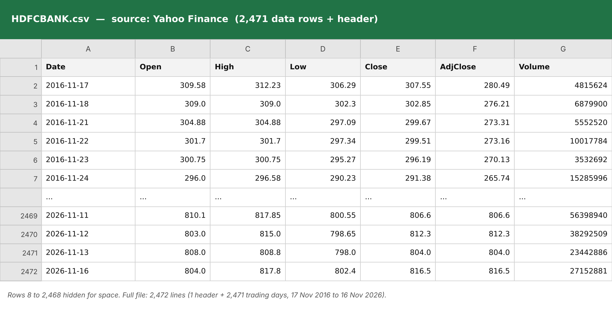 | 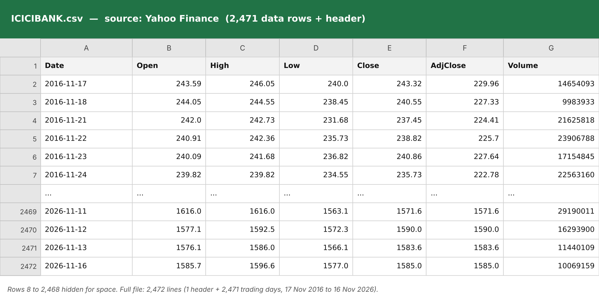 | 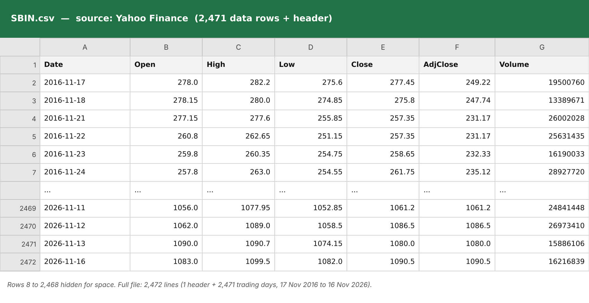 |

Sample of ICICI Bank raw data:

| Date | Open | High | Low | Close | Adj. Close | Volume |
|---|---|---|---|---|---|---|
| 2016-11-17 | 243.59 | 246.05 | 240.00 | 243.32 | 229.96 | 1.47 crore |
| 2016-11-18 | 244.05 | 244.55 | 238.45 | 240.55 | 227.33 | 1.00 crore |
| 2016-11-21 | 242.00 | 242.73 | 231.68 | 237.45 | 224.41 | 2.16 crore |

**Interpretation:** Each row is one trading day. Adjusted Close is used because it is corrected for dividends and splits, so it shows what an investor really earned.

---

## Part 1 — HDFC Bank

Starting price used: **Rs. 816.50**

### Step 1: Daily Returns

| Day | 1 | 2 | 3 | 4 | 5 | 6 | 7 | 8 | 9 | 10 |
|---|---|---|---|---|---|---|---|---|---|---|
| Return (%) | -1.54 | -1.06 | -0.05 | -1.12 | -1.64 | +2.02 | -0.41 | -0.48 | +1.76 | -0.20 |

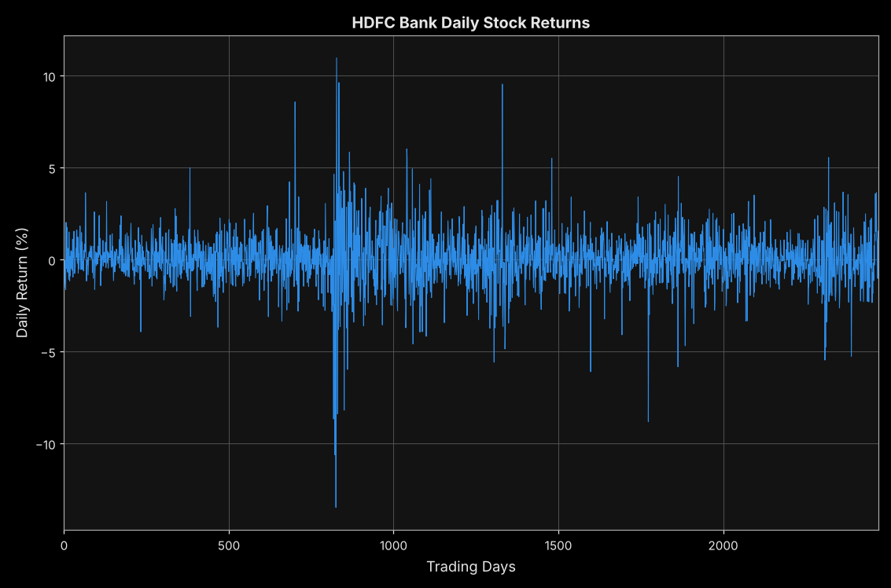

**Interpretation:** Each line is one day's gain or loss. Most days the stock moves only a little, so the chart is a thick band around zero. The big spikes (around trading day 800–850) are the COVID crash of early 2020.

### Step 2: Average Return and Risk

| Measure | Result | Meaning |
|---|---|---|
| Average daily return | 0.0433% | On a typical day the stock gained a tiny bit |
| Daily ups and downs | 1.46% | A normal day moves about 1.5% |
| Annual return | 10.90% | Rs. 100 grew about Rs. 11 per year |
| Annual volatility | 23.19% | Price can swing about 23% in a normal year |
| Best day | +10.97% | March 2020 rebound |
| Worst day | -13.47% | March 2020 COVID crash |
| Days with a loss | 48.22% | About 1 day in 2 |
| Days with a profit | 51.58% | Slightly more up days than down days |

**Interpretation:** Day by day it is almost a coin toss. The profit came because up days were a little more frequent and the long-run trend was upward.

### Step 3: How the Daily Returns Are Spread

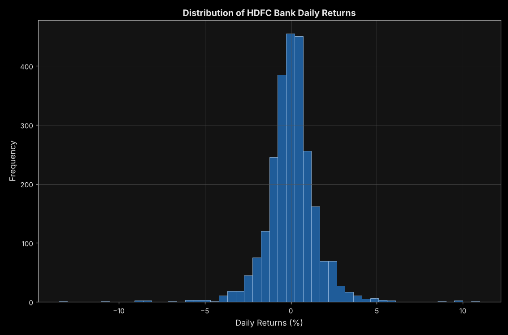

**Interpretation:** Each bar counts how many days ended with that gain or loss. About 88 out of 100 days moved less than 2% either way. The small bars far left and right are rare shock days.

### Step 4: Monte Carlo Simulation (Example)

Each day the computer picks a random number **Z** (positive = good day, negative = bad day):

| Day | Z | Simulated return | Start price | End price |
|---|---|---|---|---|
| 1 | +0.50 | 0.0433 + (1.46 × 0.50) = +0.77% | Rs. 816.50 | Rs. 822.84 |
| 2 | -1.20 | 0.0433 + (1.46 × -1.20) = -1.71% | Rs. 822.84 | Rs. 808.90 |
| 3 | +0.30 | 0.0433 + (1.46 × 0.30) = +0.48% | Rs. 808.90 | Rs. 812.80 |

This is repeated in a table of **10,000 rows (possible years) × 252 columns (trading days)** = 2,520,000 random numbers. The last column gives 10,000 final prices.

Sample results on Rs. 10,000 invested:

| Possible year | Final price | Rs. 10,000 becomes | Gain / loss |
|---|---|---|---|
| 1 | 939.1 | Rs. 11,501 | +Rs. 1,501 |
| 2 | 1,087.4 | Rs. 13,318 | +Rs. 3,318 |
| 3 | 723.9 | Rs. 8,866 | -Rs. 1,134 |
| 7 | 1,188.0 | Rs. 14,550 | +Rs. 4,550 |
| 10 | 697.1 | Rs. 8,538 | -Rs. 1,462 |

### Step 5: Monte Carlo Results

| Question | Answer | Meaning |
|---|---|---|
| Price today | Rs. 816.50 | Where every simulated year starts |
| Median price after 1 year | Rs. 912.50 | About 12% higher than today |
| Bad case (5th percentile) | Rs. 622.46 | Only 1 in 20 years ended lower |
| Good case (95th percentile) | Rs. 1,332.99 | Only 1 in 20 years ended higher |
| Chance of profit | 68.07% | About 2 in 3 years |
| Chance of loss | 31.93% | About 1 in 3 years |
| Chance of gaining 20%+ | 38.36% | A little more than 1 in 3 years |
| Chance of losing 20%+ | 7.60% | About 1 in 13 years |

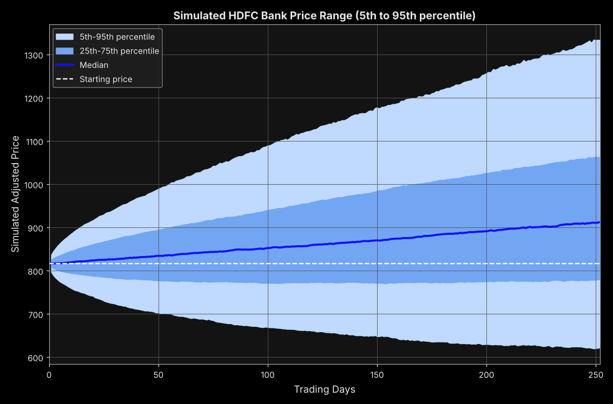

**Interpretation:** The dark line is the middle outcome. The darker shade holds the middle half of outcomes, the lighter shade holds 9 out of 10. Wider shade = more uncertain future.

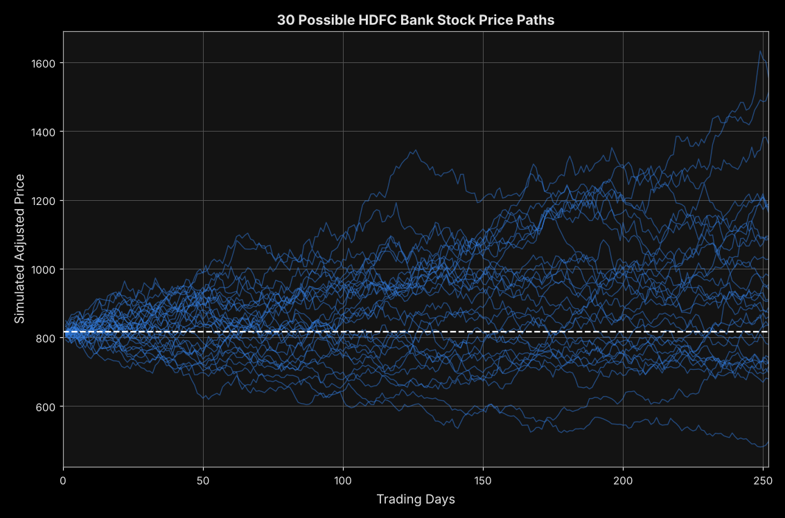

**Interpretation:** Each wiggly line is one possible year. All start at the same price (dashed line), but some go above Rs. 1,400 and some fall below Rs. 600.

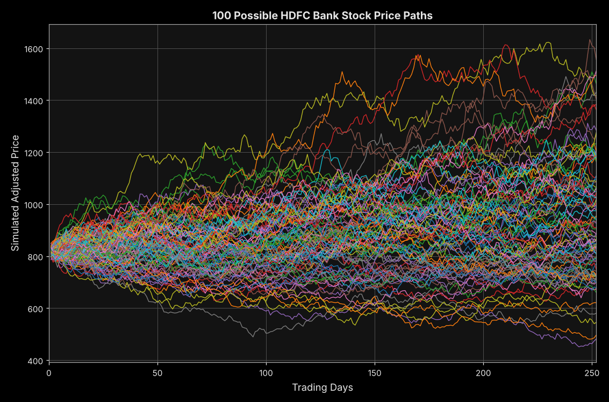

**Interpretation:** 100 possible years drawn together. Most lines drift upward, which is why profit is more likely than loss, but a good number still end lower.

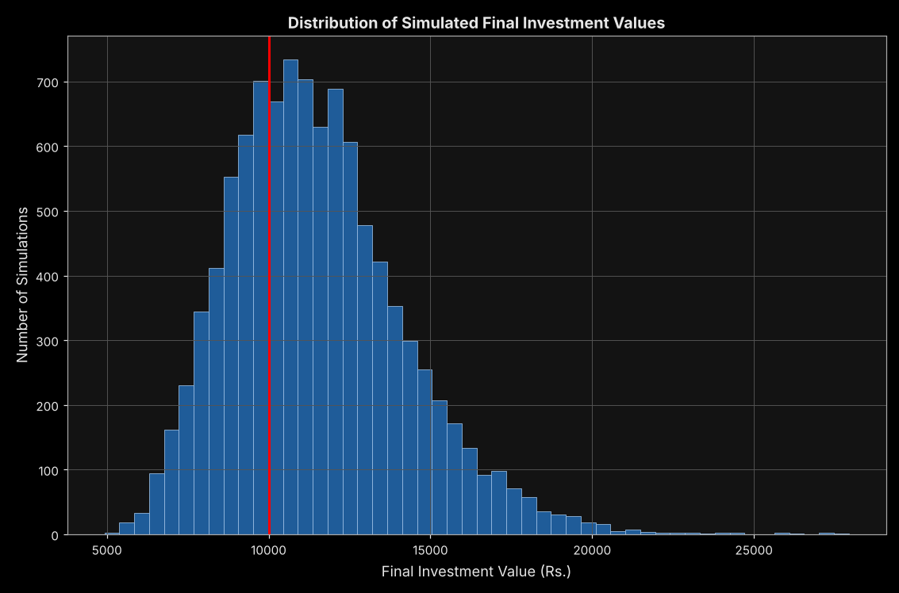

**Interpretation:** Each bar counts how many of the 10,000 years ended at that value for Rs. 10,000. The red line is Rs. 10,000 (break-even). Right of it = profit, left = loss. Most of the pile is on the right.

### Step 6: How Much Could You Lose? (VaR and CVaR)

1. Line up the 10,000 final values from worst to best.
2. Take the worst 5% = worst 500 years.
3. The best of those 500 ended at Rs. 7,624 → loss of **Rs. 2,376** = **95% VaR**.
4. The average of those 500 ended at Rs. 6,963 → loss of **Rs. 3,037** = **95% CVaR**.

| Measure | Result | Meaning |
|---|---|---|
| 95% VaR | Rs. 2,376 | In 19 years out of 20, loss should not exceed this |
| 95% CVaR | Rs. 3,037 | Average loss in the 1 bad year out of 20 |

**Interpretation:** VaR is the doorway to the bad zone; CVaR is how bad it is on average once inside.

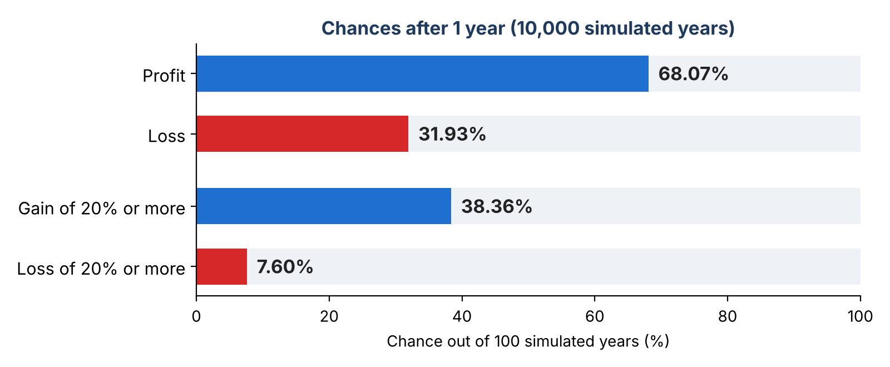

**Interpretation:** Blue bars are good outcomes, red bars are bad ones. Profit (68%) is about twice as likely as loss (32%), and a big 20% loss is rare (7.6%).

---

## Part 2 — ICICI Bank

Starting price used: **Rs. 1,585**

### Step 1: Daily Returns

| Day | 1 | 2 | 3 | 4 | 5 | 6 | 7 | 8 | 9 | 10 |
|---|---|---|---|---|---|---|---|---|---|---|
| Return (%) | -1.15 | -1.29 | +0.57 | +0.86 | -2.16 | +0.31 | -1.87 | +0.06 | +3.88 | -2.44 |

Example: 17 Nov 2016 price Rs. 229.96 → next day Rs. 227.33 → return -1.15%.

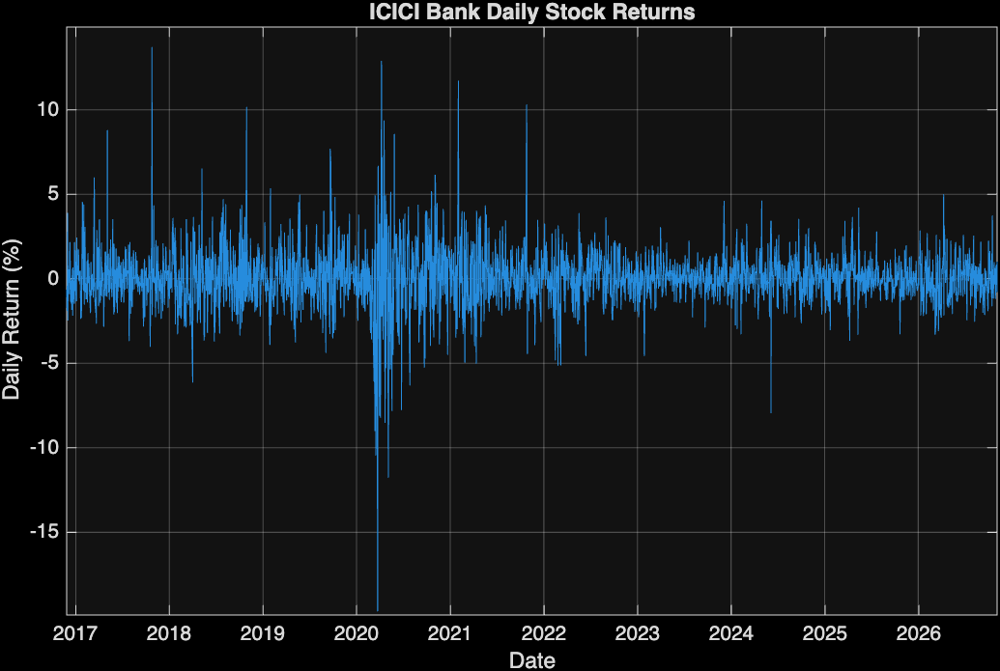

**Interpretation:** Most days move within about 2%. The huge spikes in early 2020 show the COVID crash.

### Step 2: Average Return and Risk

| Measure | Result | Meaning |
|---|---|---|
| Average daily return | 0.0782% | Small gain on a typical day |
| Annual return | 19.70% | Rs. 100 grew about Rs. 20 per year |
| Annual volatility | 28.91% | Price can swing about 29% in a normal year |
| Best day | +13.70% | 25 Oct 2017 |
| Worst day | -19.66% | 23 Mar 2020 (COVID crash) |
| Days with a loss | 49.07% | About 1 day in 2 |
| Days with a profit | 50.73% | Slightly more up days |

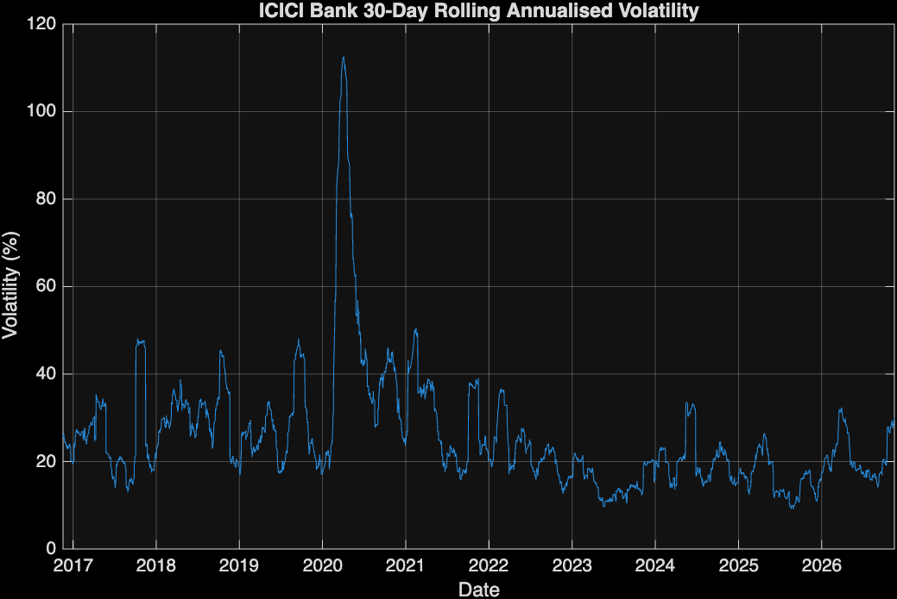

**Interpretation:** This shows how "nervous" the stock was over time. It shot above 110% in the 2020 crash and has been much calmer (about 10%–30%) since 2023.

### Step 3: Bell Curve Test (Jarque-Bera)

| Test result | Value |
|---|---|
| p-value | 0.001 (less than 0.05) |
| Verdict | Returns are **NOT** a perfect bell curve |

**Interpretation:** Very big up or down days happen more often in real life than a bell curve expects. Real crashes can be sharper than the simulation shows.

### Step 4: Biggest Fall (Maximum Drawdown)

Worst fall from a previous high: **-48.31%** (March 2020).

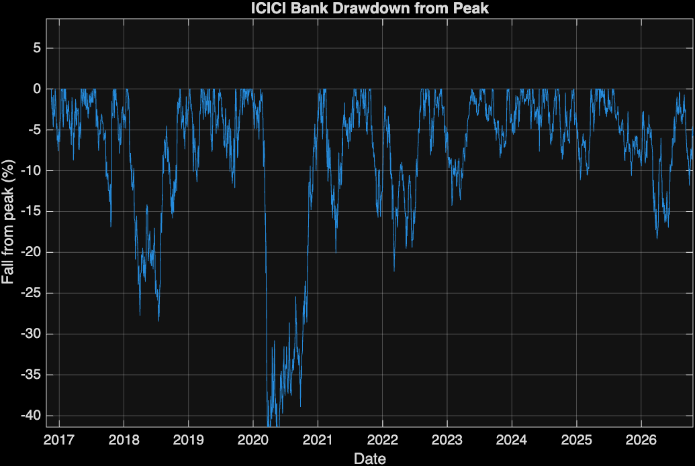

**Interpretation:** Shows how far the price was below its latest high each day. 0 = at the peak. The deep dip in 2020 is the worst fall; smaller dips of 10%–28% happened in 2018 and 2022.

### Step 5: Monte Carlo Simulation (Example)

| Day | Z | Simulated return | Start price | End price |
|---|---|---|---|---|
| 1 | +0.50 | 0.0782 + (1.82 × 0.50) = +0.99% | Rs. 1,585.00 | Rs. 1,600.75 |
| 2 | -1.20 | 0.0782 + (1.82 × -1.20) = -2.11% | Rs. 1,600.75 | Rs. 1,567.37 |
| 3 | +0.30 | 0.0782 + (1.82 × 0.30) = +0.62% | Rs. 1,567.37 | Rs. 1,577.19 |

Sample results on Rs. 10,000 invested:

| Possible year | Final price | Rs. 10,000 becomes | Gain / loss |
|---|---|---|---|
| 1 | 1,544.9 | Rs. 9,747 | -Rs. 253 |
| 2 | 2,294.4 | Rs. 14,476 | +Rs. 4,476 |
| 5 | 1,117.8 | Rs. 7,052 | -Rs. 2,948 |
| 7 | 2,120.4 | Rs. 13,378 | +Rs. 3,378 |
| 10 | 2,735.7 | Rs. 17,260 | +Rs. 7,260 |

### Step 6: Monte Carlo Results

| Question | Answer | Meaning |
|---|---|---|
| Price today | Rs. 1,585.00 | Starting point |
| Median price after 1 year | Rs. 1,935.54 | About 22% higher than today |
| Bad case (5th percentile) | Rs. 1,194.32 | Only 1 in 20 years ended lower |
| Good case (95th percentile) | Rs. 3,101.96 | Only 1 in 20 years ended higher |
| Chance of profit | 75.19% | About 3 in 4 years |
| Chance of loss | 24.81% | About 1 in 4 years |
| Chance of gaining 20%+ | 52.69% | More than half of the years |
| Chance of losing 20%+ | 7.75% | Fewer than 1 in 12 years |

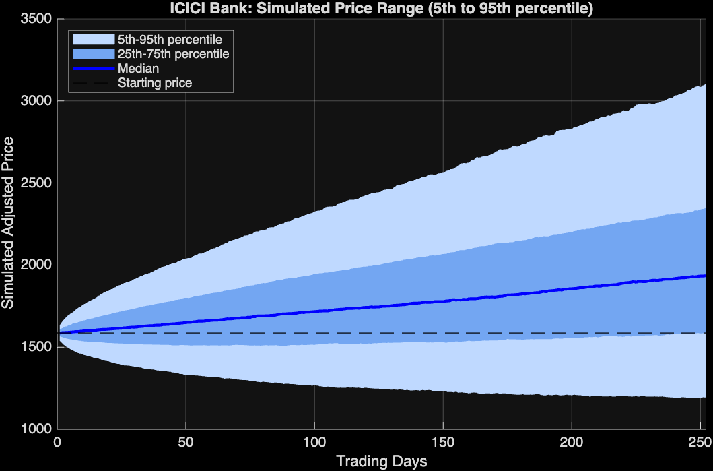

**Interpretation:** Dark line = middle outcome. Shaded area = where most outcomes land. Wider shade = more uncertainty.

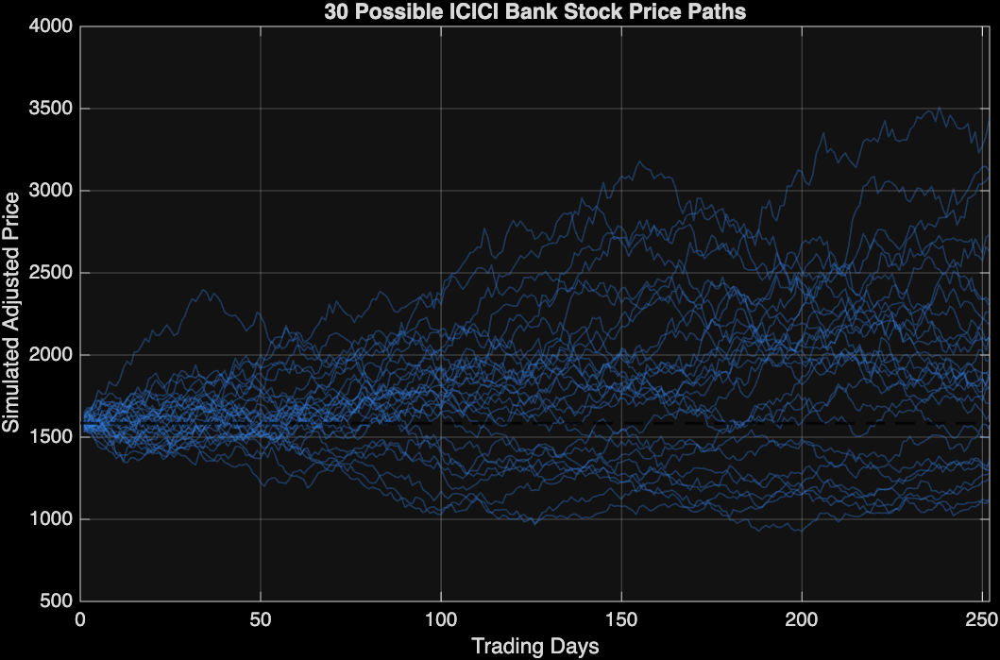

**Interpretation:** All paths start at the same price, yet some climb above Rs. 3,000 and some fall below Rs. 1,000.

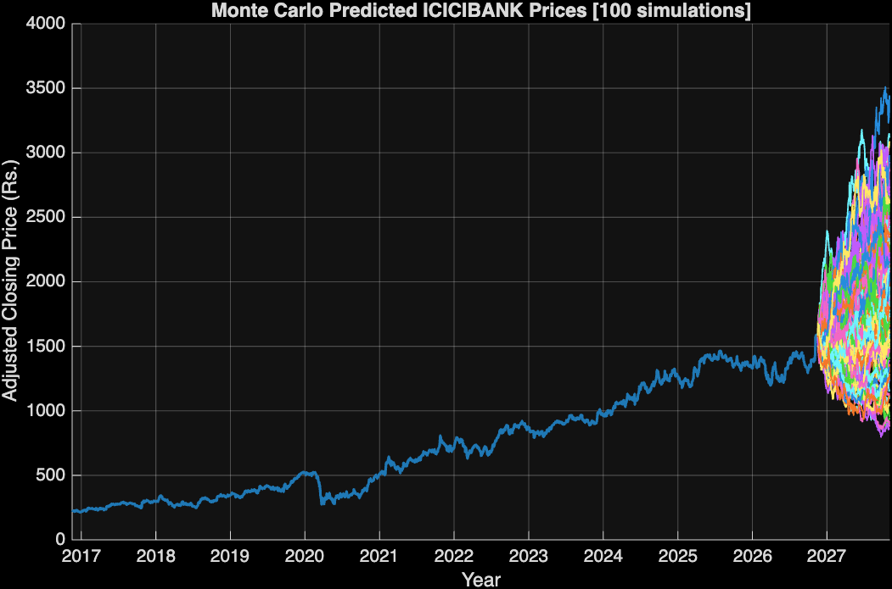

**Interpretation:** The thick line on the left is ICICI's real price history; the coloured lines on the right are 100 possible futures. It connects today's price to many possible tomorrows.

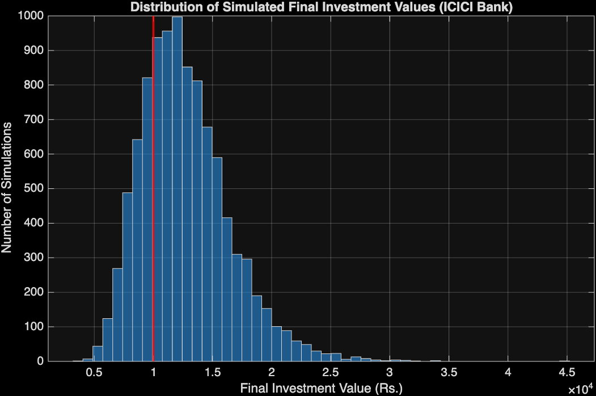

**Interpretation:** Red line = Rs. 10,000 break-even. Most of the pile sits on the profit side.

### Step 7: VaR and CVaR

1. Worst 500 of 10,000 years are taken.
2. The best of those ended at Rs. 7,535 → **95% VaR = Rs. 2,465**.
3. Their average ended at Rs. 6,695 → **95% CVaR = Rs. 3,305**.

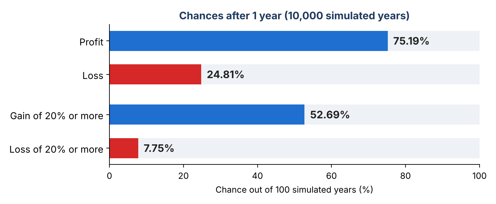

**Interpretation:** Profit (75%) is three times as likely as loss (25%). More than half the years gave 20%+ gain.

---

## Part 3 — HDFC vs ICICI vs SBI (Same 10 Years)

### Step 1: Past Performance

| Measure | HDFC Bank | ICICI Bank | SBI |
|---|---|---|---|
| Yearly return | 10.90% | **19.70%** | 15.06% |
| Yearly risk | **23.19%** | 28.91% | 31.40% |
| Best single day | +10.97% | +13.70% | **+24.44%** |
| Worst single day | **-13.47%** | -19.66% | -15.55% |
| Days that lost money | 48.22% | 49.07% | **47.37%** |
| Biggest fall from a peak | **-41.06%** | -48.31% | -59.49% |

**Interpretation:** ICICI earned the most. HDFC gave the calmest ride and the smallest big fall. SBI was the bumpiest, with the deepest fall (nearly 60%) but also the biggest one-day jump.

### Step 2: Next 12 Months (Rs. 10,000 invested)

| Question | HDFC Bank | ICICI Bank | SBI |
|---|---|---|---|
| Chance of profit | 68.29% | **75.19%** | 68.57% |
| Chance of loss | 31.71% | **24.81%** | 31.43% |
| Chance of 20%+ gain | 37.87% | **52.69%** | 46.18% |
| Chance of 20%+ loss | 8.01% | **7.75%** | 12.28% |
| Bad-year loss (95% VaR) | **Rs. 2,411** | Rs. 2,465 | Rs. 3,098 |
| Average bad-year loss (95% CVaR) | **Rs. 3,103** | Rs. 3,305 | Rs. 3,926 |

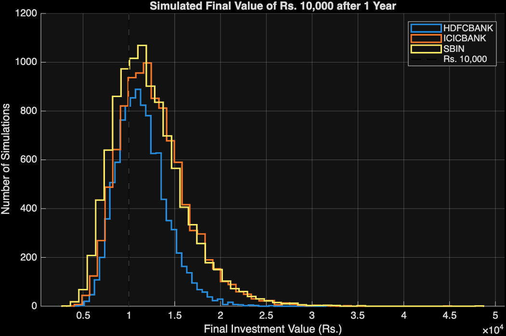

**Interpretation:** Each outline shows how the 10,000 years ended for one stock. Right of the dashed line (Rs. 10,000) = profit. HDFC (blue) is narrower — fewer big wins, but steadier. ICICI (orange) and SBI (yellow) stretch further right for bigger gains, and SBI reaches furthest left for bigger losses.

> Note: HDFC numbers here differ slightly from Part 1 because the simulation uses random numbers and gives slightly different results each run.

### Step 3: Do They Move Together? (Correlation, 0 to 1)

| Pair | Score | Meaning |
|---|---|---|
| ICICI Bank & SBI | 0.64 | Most similar, often move together |
| HDFC Bank & ICICI Bank | 0.53 | Moderately similar |
| HDFC Bank & SBI | 0.43 | Least similar, mix best |

**Interpretation:** None of the three is a twin of another. Holding more than one softens the ups and downs a little; HDFC + SBI is the best mix.

### Step 4: Scoreboard

| Category | Winner | Why |
|---|---|---|
| Highest past return | ICICI Bank | 19.70% a year |
| Calmest ride | HDFC Bank | Lowest risk (23.19%), smallest fall (-41.06%) |
| Bumpiest ride | SBI | Highest risk (31.40%), deepest fall (-59.49%) |
| Best odds of profit next year | ICICI Bank | 75.19% |
| Smallest loss in a bad year | HDFC Bank | Rs. 2,411 on Rs. 10,000 |
| Biggest chance of a large loss | SBI | 12.28% chance of losing 20%+ |

---

## Code Steps (MATLAB)

| Step | What the code does |
|---|---|
| 1 | Load the CSV and check the data (`readtable`, `head`, `summary`) |
| 2 | Keep valid Adjusted Close prices; daily return = `diff(log(Price))` |
| 3 | Mean and std of returns; yearly return = mean × 252, yearly risk = std × √252 |
| 4 | Plot daily returns |
| 5 | Histogram, best/worst day, % loss days and profit days |
| 6 | Set up simulation: start price, Rs. 10,000, N = 10,000, 252 days |
| 7 | `mu + sigma .* randn(N,Days)` → price paths with `S0 .* exp(cumsum(...,2))` |
| 8 | Final investment = 10,000 × (final price ÷ start price); profit/loss chances |
| 9 | Plot 100 paths, 30 paths, and final-value histogram |
| 10 | 5th/25th/50th/75th/95th percentile price range chart |
| 11 | 95% VaR = 5th percentile loss; 95% CVaR = average of worst 5% |

---

## Final Conclusion (In Simple Words)

- **ICICI Bank is the strongest performer.** Highest past return (19.7% a year), best chance of profit next year (about 3 in 4), and the best chance of a 20%+ gain.
- **HDFC Bank is the safest.** Calmest ride, smallest past fall, and smallest loss in a bad year — but also the lowest return (10.9% a year).
- **SBI is the riskiest.** Biggest swings, deepest past fall (nearly 60%), and the highest chance of losing 20% or more.
- **All three are coin tosses day to day** (about half the days lose money); the money is made by staying invested over time.
- **A bad year costs real money:** on Rs. 10,000, a 1-in-20 bad year loses about Rs. 2,400–3,100, and on average Rs. 3,000–3,900 in those years.
- **Crashes can be worse than the model shows,** because real returns have more extreme days than a bell curve.

**Bottom line:** Want growth → ICICI. Want safety → HDFC. Avoid SBI if you cannot handle big drops. If holding two, HDFC + SBI mix best because they move the least alike.

> This analysis is based on past data, is for learning only, and is not financial advice.
